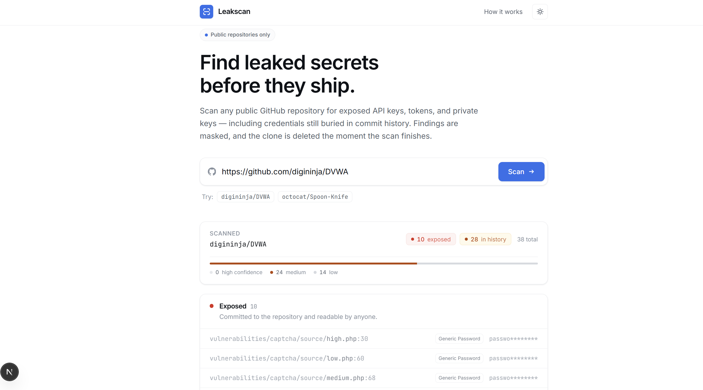
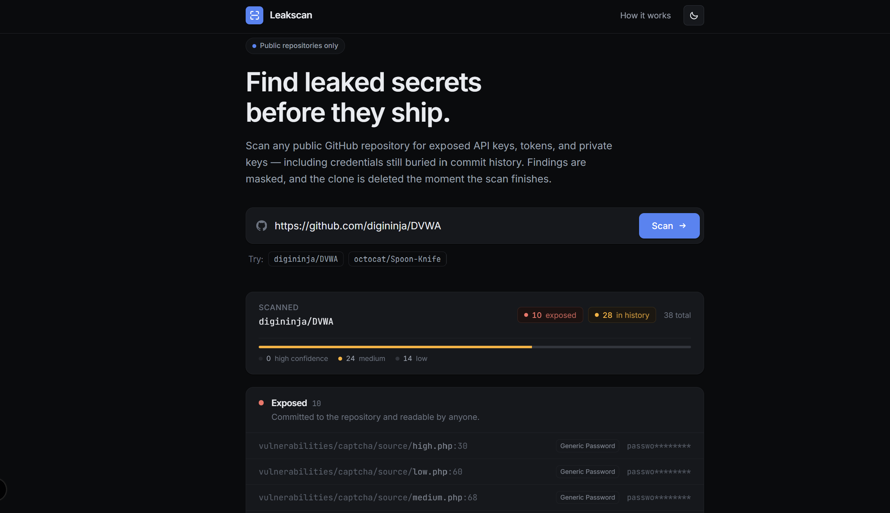
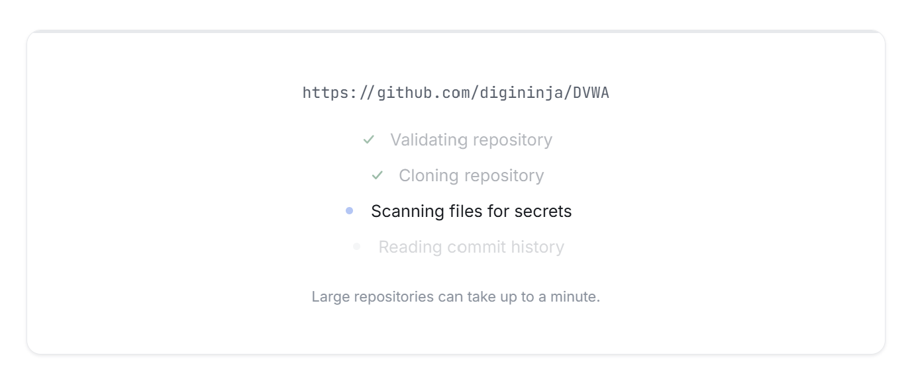
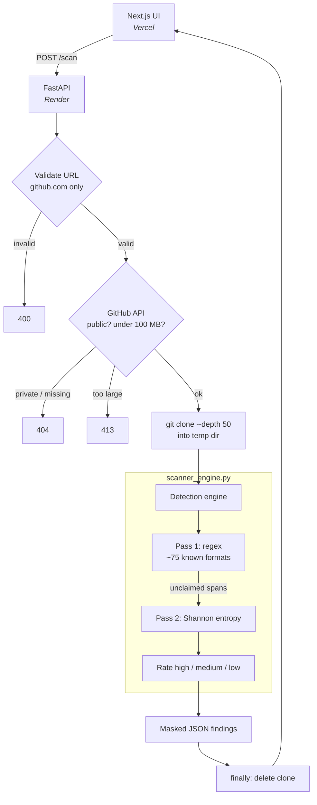

# Leakscan — Repo Secret Scanner

Paste a public GitHub repository URL and get back every credential it leaks —
API keys, tokens, private keys, connection strings — found in committed files
*and* in git history, all masked. The clone is deleted the moment the scan ends.

Built as a full-stack project: a Python detection engine, a FastAPI service
wrapping it, and a Next.js interface. The interesting engineering is in the
detection layer, and specifically in **false-positive control** — the problem
that separates a secret scanner that people use from one they mute.

<!-- SCREENSHOT: main results view, light mode, showing findings + confidence bar.
     Suggested width ~1400px, crop to browser content (no OS chrome). -->


**Stack:** Python 3.13 · FastAPI · Next.js 16 (App Router) · React 19 ·
TypeScript · Tailwind CSS 4 · pytest

---

## Contents

- [Interface](#interface)
- [Architecture](#architecture)
- [Detection engine](#detection-engine)
  - [Pass 1 — known formats](#pass-1--known-formats-regex)
  - [Pass 2 — entropy](#pass-2--entropy)
  - [Tuning: 102 false positives down to 14](#tuning-102-false-positives-down-to-14)
  - [Confidence scoring](#confidence-scoring)
- [Security constraints](#security-constraints)
- [Testing](#testing)
- [Running locally](#running-locally)
- [Deployment](#deployment)
- [Engineering notes](#engineering-notes)
- [Known limitations](#known-limitations)

---

## Interface

The UI treats confidence as its primary visual axis: high-confidence findings
get full emphasis, entropy-only hits recede. A repo whose findings are all
low-confidence should *look* different at a glance from one with a real leak.

<!-- SCREENSHOT: dark mode, results view. Same scroll position as the light shot
     above if possible — a matched pair reads well side by side. -->


<!-- SCREENSHOT: the hero + empty state before scanning (input box prominent). -->


<!-- SCREENSHOT: the loading state mid-scan, with the staged progress list. -->


Findings are grouped into two categories. **Exposed** covers everything in the
cloned working tree; **In git history** covers secrets that were committed and
later deleted, which remain recoverable from past commits.

---

## Architecture

Two deployable apps over one detection engine. The engine is pure Python with
no web dependencies — it returns plain data and never prints — so the HTTP
layer stays a thin wrapper and the detection logic can be tested without
starting a server.



| Path | Role |
| --- | --- |
| [`backend/patterns.py`](backend/patterns.py) | Pattern table, confidence ratings, Luhn validator |
| [`backend/entropy.py`](backend/entropy.py) | Shannon entropy, candidate extraction, filters |
| [`backend/scanner_engine.py`](backend/scanner_engine.py) | Orchestration: files, gitignore, git history |
| [`backend/main.py`](backend/main.py) | HTTP layer: validation, cloning, cleanup |
| [`frontend/src/lib/findings.ts`](frontend/src/lib/findings.ts) | Confidence ranking, history de-duplication |
| [`backend/tests/`](backend/tests) | Detection test suite |

---

## Detection engine

Detection runs as two passes with complementary failure modes. Regex knows
exactly what it is looking for and misses everything else; entropy finds
anything random-looking and cannot tell you what it found.

### Pass 1 — known formats (regex)

Roughly 75 credential patterns: AWS, Google, Azure, DigitalOcean, Cloudflare,
Oracle Cloud, Alibaba; OpenAI, Anthropic, Cohere, Mistral, Groq, Replicate,
Hugging Face; Stripe, Square, PayPal, and the Indonesian providers Midtrans,
Xendit, DANA, GoPay, Doku; GitHub/GitLab/npm tokens; private keys; database
URIs (Postgres, MySQL, MongoDB, Redis, MSSQL, Oracle, Neo4j, AMQP,
ClickHouse); OAuth client secrets; and webhook URLs carrying tokens.

**Card numbers get a validator, not just a regex.** A 16-digit pattern alone
matches order IDs and timestamps, so matches must also pass the
[Luhn checksum](https://en.wikipedia.org/wiki/Luhn_algorithm) — double every
second digit from the right, subtract 9 from anything over 9, and the total
must be divisible by 10. That rejects about 90% of random digit runs. Published
test numbers (`4111 1111 1111 1111`, `4242 4242 4242 4242`, …) are then
filtered out, since they appear in every payment integration doc and are never
leaks.

### Pass 2 — entropy

Shannon entropy measures how unpredictable a string is, in bits per character:

$$H = -\sum_{c} p(c) \log_2 p(c)$$

English words reuse a handful of letters and score around 3.3. A randomly
generated key spreads evenly across its alphabet and approaches its ceiling —
`log₂(16) = 4.0` for hex, `log₂(64) = 6.0` for base64. That gap is the signal,
and it is what catches an in-house token format no pattern list will ever cover.

Measured on real strings:

| String | Entropy | Verdict |
| --- | --- | --- |
| `administratorpassword` | 3.33 | word |
| `configurationsettings` | 3.43 | word |
| `kJ8xQm2vPzR7tYw3NcLb9FhD` | 4.59 | **key** |
| `Xq7Lm2Pv9Rt4Wz6Yb8Nc3Fd5` | 4.59 | **key** |

The pass runs *second* by design: it only examines spans the regex pass did not
claim, so a known key is reported once by the rule that named it rather than
twice.

**A subtlety that drove the threshold.** A string of length *n* has at most *n*
distinct characters, so it cannot score above `log₂(n)` — a 20-character string
caps at 4.32 bits no matter how random it is. That is why the base64 threshold
sits at **4.0** and not the 4.5 used by tools that slide windows across longer
strings. With a 20-character minimum, 4.5 is nearly unreachable.

Everything is tunable in `EntropyConfig`, by argument, or through
`LEAKSCAN_ENTROPY_*` environment variables:

```python
@dataclass(frozen=True)
class EntropyConfig:
    min_length: int = 20
    base64_threshold: float = 4.0   # ceiling is 6.0
    hex_threshold: float = 3.0      # ceiling is 4.0
    min_digits: int = 2
```

### Tuning: 102 false positives down to 14

The first working version was unusable. Scanning
[DVWA](https://github.com/digininja/DVWA) produced **102** low-confidence
findings — things like `,CONVE`, `).valu`, `;for(r`. They were fragments of
minified JavaScript and inline SQL: my candidate regex accepted any non-quote
character, so dense punctuation-heavy code scored as "random."

Three filters, each with a reason rather than a magic number:

| Filter | Rationale |
| --- | --- |
| Restrict candidates to `[A-Za-z0-9+/=_.~-]` | Real credentials are base64/base62/hex. They never contain `(){};,` — code does. |
| Require ≥ 2 digits | A random 20-char base62 key averages ~3 digits; having fewer than 2 happens ~2% of the time. Camel-case identifiers rarely survive it. |
| Drop base64 that decodes to readable text | Encoded copy and config blobs are legitimately high-entropy but are not credentials. Random key material decoding to clean ASCII is effectively impossible. |

Plus structural exclusions for UUIDs, git SHAs and content digests
(32/40/64-char hex), URLs, version strings, dates, and obvious placeholders —
and the entropy pass is skipped entirely inside lockfiles and minified bundles,
which are wall-to-wall content hashes by nature.

**Result: 102 → 14**, and the survivors are all genuinely random tokens (a CSP
nonce, a PHP session id, a test connection string) correctly labelled low
confidence.

> **The most useful thing I learned building this:** entropy alone does not
> separate words from keys. The phrase `thequickbrownfoxjumped` scores **4.19**
> — *above* the threshold — because a pangram uses nearly the whole alphabet,
> which is exactly what entropy rewards. What actually rejects it is the
> mixed-charset filter: prose has no digits. The threshold gets the attention,
> but the filters do the work. That assumption is pinned by a named regression
> test so it cannot quietly rot.

### Confidence scoring

Every finding is rated, and the rating drives both sort order and visual weight:

| Confidence | Source | Example |
| --- | --- | --- |
| **High** | Provider-specific shape | `AKIA…` is an AWS key and essentially nothing else |
| **Medium** | Generic keyword rules, JWTs, valid cards | `password = "…"` — real hits, but where the noise lives |
| **Low** | Entropy-only | No known format matched; the string just looks random |

This directly addresses the generic-password noise problem: scanning DVWA
reports 24 medium and 14 low with **zero** high-confidence findings, which is
the honest summary — that repo's "secrets" are password variables in
deliberately vulnerable PHP sample code, not live credentials.

<!-- SCREENSHOT (optional): close-up of the summary bar showing the
     high/medium/low breakdown. -->


---

## Security constraints

The scanner clones untrusted repositories on request, so the threat model
matters:

- **Public `github.com` only.** The URL is regex-validated before anything is
  cloned — this rejects other hosts, `git@` SSH forms, `file://`, path
  traversal, and lookalike domains such as `github.com.evil.io`.
- **Pre-flight before disk.** The GitHub API confirms the repo is public and
  under 100 MB *before* cloning, so a huge repo is rejected without a download.
- **Bounded work.** Shallow clone (`--depth 50`), 90-second timeout, and
  `GIT_TERMINAL_PROMPT=0` so a credential prompt can never hang a worker.
- **Guaranteed cleanup.** Clones are removed in a `finally` block; any orphaned
  by a killed process are swept on the next startup, since `finally` cannot run
  through a `SIGKILL` or a platform restart.
- **Nothing sensitive leaves the box.** The engine masks every value, absolute
  paths are rewritten to repo-relative before they reach a response, and full
  secrets and scanned source are never logged, stored, or returned. Clone
  failures log git's stderr *server-side only*, because stderr can echo a URL.
- **CORS fails closed.** Unset `ALLOWED_ORIGINS` permits localhost only, never
  a wildcard.

---

## Testing

63 tests covering the detection layer, run with:

```bash
cd backend && python -m pytest
```

The suite pins both failure modes rather than just the happy path: that entropy
catches a random key regex misses, *and* that it stays silent on prose, git
SHAs, UUIDs, placeholders, and short strings; that card detection requires a
valid Luhn checksum; that published test cards are ignored; that a regex-matched
key is never re-reported by the entropy pass; and that the threshold is
genuinely tunable in both directions.

---

## Running locally

Backend — http://localhost:8000, interactive docs at `/docs`:

```bash
cd backend && pip install -r requirements.txt && uvicorn main:app --reload
```

Frontend — http://localhost:3000:

```bash
cd frontend && npm install && npm run dev
```

With `ALLOWED_ORIGINS` unset the API accepts any localhost port, so the
frontend works regardless of which port `next dev` picks.

<!-- SCREENSHOT (optional): the FastAPI /docs page with POST /scan expanded. -->


---

## Deployment

Backend to Render, frontend to Vercel. **Deploy the backend first** —
`NEXT_PUBLIC_API_URL` is inlined into the frontend bundle at *build* time, so
if Vercel builds before the API URL exists, the site ships with
`localhost:8000` baked in and needs a full redeploy to correct.

**1. Backend → Render.** Dashboard → New → Blueprint → select this repo.
[`render.yaml`](render.yaml) supplies the runtime, build and start commands,
and health check. Note the assigned URL.

**2. Frontend → Vercel.** Import the repo and set:

| Setting | Value |
| --- | --- |
| Root Directory | `frontend` |
| `NEXT_PUBLIC_API_URL` | the Render URL from step 1, no trailing slash |

Root Directory must be set in the Vercel dashboard — it cannot be configured
from a file at the repo root.

**3. Connect them.** Back in Render, set `ALLOWED_ORIGINS` to the Vercel domain
and redeploy. This step is required: unset, the API allows localhost only and
the deployed frontend fails with a CORS error. That is deliberate — an
unconfigured deployment fails closed rather than serving every origin on the
internet. Pass a comma-separated list to also allow preview deployments.

---

## Engineering notes

A few decisions that were less obvious than they look:

**The engine has no web dependencies.** `scanner_engine.py` returns plain data
and never prints, so presentation lives entirely in the layer above it. That
keeps the HTTP handler thin and lets detection be tested without spinning up a
server — which is why 63 tests run in 0.2 seconds.

**Regex spans feed the entropy pass.** The regex pass records the character
ranges it matched, and entropy examines only what is left. Without this, every
recognised key would be reported twice — once by name, once as an anonymous
high-entropy blob.

**Git history is bounded, and says so.** History scanning wants depth; a
shallow clone wants speed. The clone is capped at 50 commits and the API
returns `history_depth`, so the UI can state that coverage is capped rather
than implying the history is clean.

**Duplicate history findings collapse.** One commit often re-adds the same
value across many lines. Identical `(commit, type, value)` triples group into a
single row with an `×6` count — DVWA's 18 history findings become 3 readable
rows, with the true count still shown in the section header.

**Theme switching holds no React state.** The toggle writes a class on
`<html>`; icons swap in CSS. A `beforeInteractive` script applies the stored
theme before first paint, so dark-mode visitors never see a white flash and SSR
markup can never disagree with the DOM.

---

## Known limitations

Honest about what this does not do yet:

- **Entropy thresholds are tuned against one repository.** DVWA drove the
  filters. Expect to adjust `EntropyConfig` once a broader corpus goes through.
- **Git history is capped at 50 commits.** Secrets older than that are not
  found. Raising the cap costs clone time linearly.
- **Generic patterns are still noisy by construction.** `password = "…"` cannot
  distinguish a live credential from sample code. Confidence scoring manages
  the noise rather than eliminating it.
- **Render's free tier sleeps.** The first scan after an idle period pays a
  cold start of roughly 30–60 seconds.
- **Unauthenticated GitHub API access is limited to 60 requests/hour.** Past
  that the pre-flight is skipped and a private repo surfaces as a clone failure
  rather than a clean "repository is private" message.
